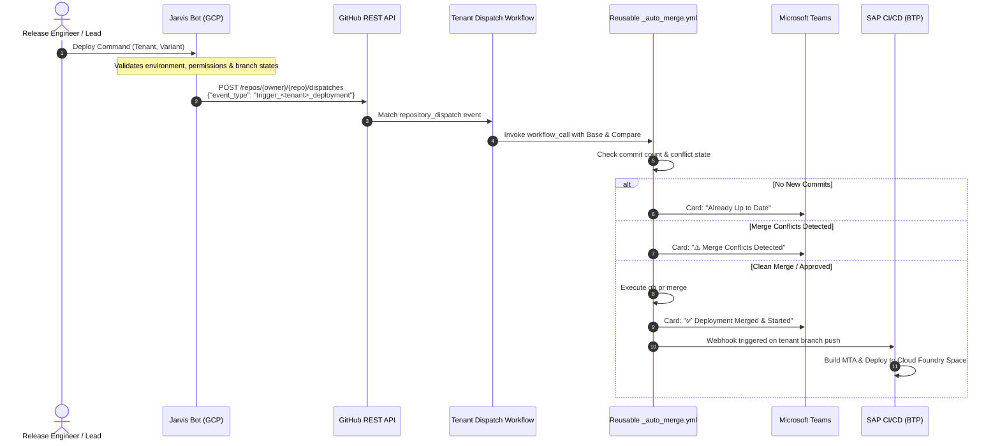
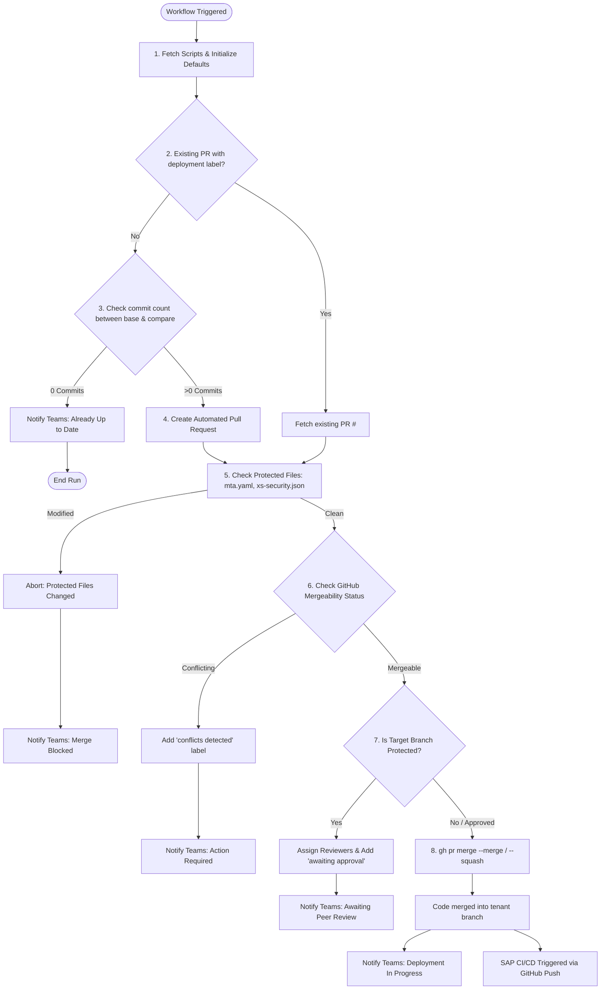
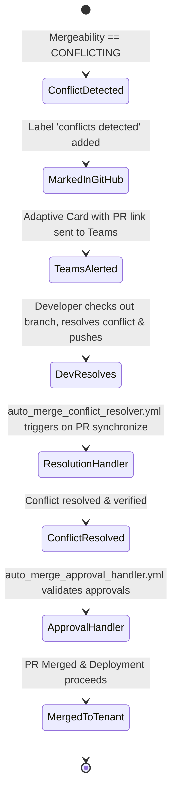

# Direct Merge Deployment Architecture & Flow Guide

**Document Title:** Direct Merge Deployment Architecture & Tenant Flow Guide  
**System:** AsInt Enterprise Multi-Tenant Deployment Automation  
**Author:** Platform & DevOps Engineering  
**Version:** 1.0  
**Trigger Engine:** Jarvis Bot (Hosted on Google Cloud Platform — GCP)  
**Execution Engine:** GitHub Actions & SAP Continuous Integration and Delivery (CI/CD)  
**Target Infrastructure:** SAP Business Technology Platform (BTP) / Cloud Foundry (CF)  

---

## 1. Executive Summary & Purpose

This technical guide documents the **Direct Merge Deployment Flow** used across AsInt's multi-tenant SAP applications on SAP Business Technology Platform (BTP). 

The platform supports **14 customer and internal tenant environments**, each built across **three distinct module variants**:
1. **CORE** (Main application services & database artifacts)
2. **DC** (Data Collector service layer)
3. **DC AddIn** (Data Collector Add-In extensions)

Unlike the APM-02 environment (which employs a snapshot-and-wait window cycle), these 14 tenants use **Direct Automated Merges** orchestrated by reusable GitHub Actions workflows (`_auto_merge.yml`), triggered via API by the **Jarvis Bot** hosted on **Google Cloud Platform (GCP)**.

```
+---------------------------------------------------------------------------------------------------+
|                                      END-TO-END FLOW OVERVIEW                                     |
+---------------------------------------------------------------------------------------------------+
|                                                                                                   |
|  [ Operator / Release Lead ]                                                                      |
|               │                                                                                   |
|               ▼ (Chat / API / Schedule)                                                           |
|     ┌───────────────────┐                                                                         |
|     │    Jarvis Bot     │  Hosted on Google Cloud Platform (GCP)                                   |
|     │     (on GCP)      │  Triggers GitHub via `repository_dispatch` REST API                     |
|     └─────────┬─────────┘                                                                         |
|               │                                                                                   |
|               ▼ POST /repos/{owner}/{repo}/dispatches {"event_type": "trigger_<tenant>_deployment"}|
|     ┌────────────────────────┐                                                                    |
|     │ Tenant Deploy Workflow │  e.g., deploy_apm01.yml, deploy_ais02_dc.yml, etc.                 |
|     └─────────┬──────────────┘                                                                    |
|               │                                                                                   |
|               ▼ Calls reusable workflow with inputs (base, compare, deployment_name)              |
|     ┌────────────────────────┐                                                                    |
|     │    _auto_merge.yml     │  1. Check diffs & commit count                                     |
|     │   (Reusable Engine)    │  2. Create PR & verify protected files (mta.yaml, etc.)            |
|     │                        │  3. Check mergeability / detect conflicts                          |
|     │                        │  4. Handle branch protection & reviewer approvals                  |
|     │                        │  5. Merge PR into target tenant branch                             |
|     │                        │  6. Notify Microsoft Teams via Adaptive Cards                      |
|     └─────────┬──────────────┘                                                                    |
|               │                                                                                   |
|               ▼ Git Push / Merge Event on `tenant/*` branch                                       |
|     ┌────────────────────────┐                                                                    |
|     │   SAP BTP CI/CD        │  Builds MTA artifact & deploys to target BTP Cloud Foundry space   |
|     │     Pipeline           │  Reports status back via webhooks to Teams                         |
|     └────────────────────────┘                                                                    |
+---------------------------------------------------------------------------------------------------+
```

---

## 2. Triggering Architecture: Jarvis Bot on GCP

The deployment trigger is decoupled from developer git commits and managed centrally through the **Jarvis Bot**, a custom automation service hosted on **Google Cloud Platform (GCP)**.



### Jarvis Bot Invocation Payload
When Jarvis triggers a deployment from GCP, it issues an HTTP POST request to GitHub's REST API:

```http
POST /repos/Daxesh-Asint/GitHub-Actions-Trial-2/dispatches HTTP/1.1
Host: api.github.com
Authorization: Bearer <GCP_MANAGED_GITHUB_PAT>
Accept: application/vnd.github.v3+json
Content-Type: application/json

{
  "event_type": "trigger_apm01_deployment",
  "client_payload": {
    "requested_by": "jarvis-bot",
    "environment": "APM-01",
    "variant": "CORE",
    "source_branch": "main",
    "target_branch": "tenant/asint-apm-01-new"
  }
}
```

---

## 3. Comprehensive Tenant & Variant Deployment Matrix

Below is the complete matrix of all **14 Direct Merge Tenants** across all **3 Variants** (42 total automated pipelines). Every entry details the source branch (`compare`), the target branch (`base`), the GCP Jarvis trigger event, and the specific GitHub Actions workflow file:

| # | Tenant Environment | Variant | Source Branch (`compare`) | Target Tenant Branch (`base`) | Jarvis Bot Dispatch Event | Workflow File |
|:---|:---|:---|:---|:---|:---|:---|
| **1** | **AIS-02** | **CORE** | `dev` | `tenant/asint-ais-02` | `trigger_ais02_deployment` | `merge_dev_to_tenant_ais02.yml` |
| | | **DC** | `dev` | `tenant/asint-ais-02-dc` | `trigger_ais02_dc_deployment` | `deploy_ais02_dc.yml` |
| | | **DC AddIn** | `dev` | `tenant/asint-ais-02-dc-addin` | `trigger_ais02_dc_addin_deployment` | `deploy_ais02_dc_addin.yml` |
| **2** | **APM-01** | **CORE** | `main` | `tenant/asint-apm-01-new` | `trigger_apm01_deployment` | `deploy_apm01.yml` |
| | | **DC** | `main-dc` | `tenant/asint-apm-01-dc` | `trigger_apm01_dc_deployment` | `deploy_apm01_dc.yml` |
| | | **DC AddIn** | `main-dc-addin` | `tenant/asint-apm-01-dc-addin` | `trigger_apm01_dc_addin_deployment` | `deploy_apm01_dc_addin.yml` |
| **3** | **APM-EIOT** | **CORE** | `main` | `apm-eiot-temp-copy` | `trigger_apm_eiot_deployment` | `deploy_apm_eiot.yml` |
| | | **DC** | `main-dc` | `tenant/asint-apm-eiot-dc` | `trigger_apm_eiot_dc_deployment` | `deploy_apm_eiot_dc.yml` |
| | | **DC AddIn** | `main-dc-addin` | `tenant/asint-apm-eiot-dc-addin` | `trigger_apm_eiot_dc_addin_deployment` | `deploy_apm_eiot_dc_addin.yml` |
| **4** | **AsInt Demo** | **CORE** | `main` | `tenant/asint-demo` | `trigger_asint_demo_deployment` | `deploy_asint_demo.yml` |
| | | **DC** | `main-dc` | `tenant/asint-demo-dc` | `trigger_asint_demo_dc_deployment` | `deploy_asint_demo_dc.yml` |
| | | **DC AddIn** | `main-dc-addin` | `tenant/asint-demo-dc-addin` | `trigger_asint_demo_dc_addin_deployment` | `deploy_asint_demo_dc_addin.yml` |
| **5** | **IRC** | **CORE** | `main` | `tenant/asint-irc-temp` | `trigger_irc_deployment` | `deploy_irc.yml` |
| | | **DC** | `main-dc` | `tenant/irc-dc` | `trigger_irc_dc_deployment` | `deploy_irc_dc.yml` |
| | | **DC AddIn** | `main-dc-addin` | `tenant/irc-dc-addin` | `trigger_irc_dc_addin_deployment` | `deploy_irc_dc_addin.yml` |
| **6** | **ST (ST Env)** | **CORE** | `dev` | `st-env-for-contentfederation` | `trigger_st_env_deployment` | `deploy_st_env.yml` |
| | | **DC** | `dev` | `tenant/asint-st-env-dc` | `trigger_st_env_dc_deployment` | `deploy_st_env_dc.yml` |
| | | **DC AddIn** | `dev` | `tenant/asint-st-env-dc-addin` | `trigger_st_env_dc_addin_deployment` | `deploy_st_env_dc_addin.yml` |
| **7** | **Baystar** | **CORE** | `main` | `tenant/baystar` | `trigger_baystar_deployment` | `deploy_baystar.yml` |
| | | **DC** | `main-dc` | `tenant/baystar-dc` | `trigger_baystar_dc_deployment` | `deploy_baystar_dc.yml` |
| | | **DC AddIn** | `main-dc-addin` | `tenant/baystar-dc-addin` | `trigger_baystar_dc_addin_deployment` | `deploy_baystar_dc_addin.yml` |
| **8** | **HSC Non Prod** | **CORE** | `main` | `tenant/hemlock-non-prod` | `trigger_hsc_non_prod_deployment` | `deploy_hsc_non_prod.yml` |
| | | **DC** | `main-dc` | `tenant/hemlock-non-prod-dc` | `trigger_hsc_non_prod_dc_deployment` | `deploy_hsc_non_prod_dc.yml` |
| | | **DC AddIn** | `main-dc-addin` | `tenant/hemlock-non-prod-dc-addin` | `trigger_hsc_non_prod_dc_addin_deployment` | `deploy_hsc_non_prod_dc_addin.yml` |
| **9** | **HSC Prod** | **CORE** | `tenant/hemlock-non-prod` | `tenant/hemlock-prod` | `trigger_hsc_prod_deployment` | `deploy_hsc_prod.yml` |
| | | **DC** | `tenant/hemlock-non-prod-dc` | `tenant/hemlock-prod-dc` | `trigger_hsc_prod_dc_deployment` | `deploy_hsc_prod_dc.yml` |
| | | **DC AddIn** | `tenant/hemlock-non-prod-dc-addin` | `tenant/hemlock-prod-dc-addin` | `trigger_hsc_prod_dc_addin_deployment` | `deploy_hsc_prod_dc_addin.yml` |
| **10** | **Indorama Prod-900** | **CORE** | `tenant/indorama-qa-233` | `tenant/indorama-prod-900` | `trigger_indorama_prod_900_deployment` | `deploy_indorama_prod_900.yml` |
| | | **DC** | `tenant/indorama-qa-233-dc` | `tenant/indorama-prod-900-dc` | `trigger_indorama_prod_900_dc_deployment` | `deploy_indorama_prod_900_dc.yml` |
| | | **DC AddIn** | `tenant/indorama-qa-233-dc-addin` | `tenant/indorama-prod-900-dc-addin` | `trigger_indorama_prod_900_dc_addin_deployment` | `deploy_indorama_prod_900_dc_addin.yml` |
| **11** | **Indorama Prod-933** | **CORE** | `tenant/indorama-qa-234` | `tenant/indorama-prod-933` | `trigger_indorama_prod_933_deployment` | `deploy_indorama_prod_933.yml` |
| | | **DC** | `tenant/indorama-qa-234-dc` | `tenant/indorama-prod-933-dc` | `trigger_indorama_prod_933_dc_deployment` | `deploy_indorama_prod_933_dc.yml` |
| | | **DC AddIn** | `tenant/indorama-qa-234-dc-addin` | `tenant/indorama-prod-933-dc-addin` | `trigger_indorama_prod_933_dc_addin_deployment` | `deploy_indorama_prod_933_dc_addin.yml` |
| **12** | **Indorama QA-233** | **CORE** | `main` | `tenant/indorama-qa-233` | `trigger_indorama_qa_233_deployment` | `deploy_indorama_qa_233.yml` |
| | | **DC** | `main-dc` | `tenant/indorama-qa-233-dc` | `trigger_indorama_qa_233_dc_deployment` | `deploy_indorama_qa_233_dc.yml` |
| | | **DC AddIn** | `main-dc-addin` | `tenant/indorama-qa-233-dc-addin` | `trigger_indorama_qa_233_dc_addin_deployment` | `deploy_indorama_qa_233_dc_addin.yml` |
| **13** | **Indorama QA-234** | **CORE** | `main` | `tenant/indorama-qa-234` | `trigger_indorama_qa_234_deployment` | `deploy_indorama_qa_234.yml` |
| | | **DC** | `main-dc` | `tenant/indorama-qa-234-dc` | `trigger_indorama_qa_234_dc_deployment` | `deploy_indorama_qa_234_dc.yml` |
| | | **DC AddIn** | `main-dc-addin` | `tenant/indorama-qa-234-dc-addin` | `trigger_indorama_qa_234_dc_addin_deployment` | `deploy_indorama_qa_234_dc_addin.yml` |
| **14** | **VMOS** | **CORE** | `main` | `tenant/vmos-dev` | `trigger_vmos_deployment` | `deploy_vmos.yml` |
| | | **DC** | `main-dc` | `tenant/vmos-dc` | `trigger_vmos_dc_deployment` | `deploy_vmos_dc.yml` |
| | | **DC AddIn** | `main-dc-addin` | `tenant/vmos-dc-addin` | `trigger_vmos_dc_addin_deployment` | `deploy_vmos_dc_addin.yml` |

---

## 4. Key Flow Patterns Explained

From the matrix above, three distinct promotion patterns exist across the fleet:

### Pattern A: Standard Release Promotion (`main` / `main-dc` / `main-dc-addin`)
Used by most customer and QA tenants:
* **APM-01**, **APM-EIOT**, **AsInt Demo**, **IRC**, **Baystar**, **HSC Non Prod**, **Indorama QA-233**, **Indorama QA-234**, **VMOS**
* **Mechanism:** Merges stable code from upstream branch into target tenant branch.
* **Branches:**
  * CORE: `main` ➔ `tenant/<tenant-name>`
  * DC: `main-dc` ➔ `tenant/<tenant-name>-dc`
  * DC AddIn: `main-dc-addin` ➔ `tenant/<tenant-name>-dc-addin`

### Pattern B: Development Stream Promotion (`dev`)
Used by active development and integration environments:
* **AIS-02** and **ST (ST Env)**
* **Mechanism:** All three variants promote directly from the active `dev` trunk branch into the tenant branches to validate work-in-progress features.

### Pattern C: Multi-Stage Staged Promotion (QA ➔ Production)
Used by production client environments that require prior QA validation:
* **HSC Prod:** Promoted from **HSC Non Prod** (`tenant/hemlock-non-prod*` ➔ `tenant/hemlock-prod*`)
* **Indorama Prod-900:** Promoted from **Indorama QA-233** (`tenant/indorama-qa-233*` ➔ `tenant/indorama-prod-900*`)
* **Indorama Prod-933:** Promoted from **Indorama QA-234** (`tenant/indorama-qa-234*` ➔ `tenant/indorama-prod-933*`)
* **Benefit:** Ensures that exactly what was tested in QA is promoted to Production with zero divergence.

---

## 5. Reusable Auto-Merge Engine (`_auto_merge.yml`)

Every tenant wrapper workflow delegates execution to the reusable workflow `.github/workflows/_auto_merge.yml`.

### Detailed Workflow Step Lifecycle



### Core Safety & Integrity Gates in `_auto_merge.yml`:

1. **Concurrency Control:**
   ```yaml
   concurrency:
     group: auto-merge-${{ inputs.base }}
     cancel-in-progress: false
   ```
   Ensures that concurrent merges into the same tenant branch are serialized without corrupting git history.

2. **Protected File Verification:**
   Before any merge is permitted, the engine inspects the Pull Request file list:
   ```bash
   CHANGED_FILES=$(gh pr view "$PR_NUMBER" --json files --jq '.files[].path')
   if echo "$CHANGED_FILES" | grep -E '(^|/)mta\.yaml$|(^|/)xs-security\.json$'; then
     echo "Auto-merge blocked: Protected files modified."
     exit 1
   fi
   ```
   *Rationale:* `mta.yaml` and `xs-security.json` contain environment-specific routing, service credentials, and CF destination configurations. Overwriting these breaks tenant isolation on BTP.

3. **Merge Conflict Detection:**
   The workflow polls GitHub's mergeability status for up to 100 seconds (10 attempts × 10s):
   * If `MERGEABLE`: Proceeds to approval or merge.
   * If `CONFLICTING`: Applies the label `conflicts detected`, comments the PR with clear resolution instructions, and sends an urgent Adaptive Card to Teams.

4. **Branch Protection & Peer Approval Gates:**
   If the target tenant branch is protected (e.g., Production branches), the auto-merge engine automatically assigns designated reviewers (`DEFAULT_REVIEWERS` or specific inputs), applies `awaiting approval`, and suspends the merge until an approved review is submitted.

5. **Merge Fallback Mechanism:**
   Attempts standard merge (`--merge --admin` or `--merge`) to retain accurate git ancestry; falls back to squash merge (`--squash`) if repository policy requires linear history.

---

## 6. Pre-Merge Actions & Cloud Foundry Memory Management

In SAP BTP Cloud Foundry environments, memory quota is constrained. If an application update requires staging a new droplet before the old one is terminated (blue-green), quota overflow can cause deployment failures.

### Central Environment Registry (`.github/cf-apps.json`)
The workflow engine resolves CF configuration dynamically from `.github/cf-apps.json`:
* API Endpoint (e.g., `https://api.cf.eu10-004.hana.ondemand.com`)
* Org (e.g., `ais-02-eu10-org`, `asint-apm-01`, etc.)
* Space (e.g., `main`, `demo`, `prod`)
* Associated CF microservices to monitor/manage (e.g., `crawler-layer-backend`)

When configured, the engine can stop non-essential backend background workers before the merge, freeing memory quota for the incoming MTA deployment container.

---

## 7. Conflict Detection and Resolution Lifecycle

When merge conflicts occur between the source branch and the tenant branch, the system executes an automated recovery lifecycle:



### Automated Handler Workflows:
1. **`auto_merge_conflict_resolver.yml`:**
   * Triggers automatically when a developer pushes conflict resolution commits (`pull_request: [synchronize]`).
   * Validates that all conflicts are cleared and that protected files remain untouched.
   * Updates Teams card status from "Conflict" to "Conflict Resolved — Verifying".
2. **`auto_merge_approval_handler.yml`:**
   * Triggers when an assigned reviewer submits an approval (`pull_request_review: [submitted]`).
   * Merges the PR immediately upon approval without requiring manual intervention.
   * Dispatches success notifications and hands off to SAP CI/CD.

---

## 8. Downstream SAP CI/CD Deployment Process

Once the merge completes into the tenant branch:
1. **GitHub Push Event:** GitHub pushes the commit to `refs/heads/tenant/<name>`.
2. **SAP Webhook Listener:** The SAP Continuous Integration and Delivery service on BTP catches the push webhook.
3. **MTA Build & Validation:** SAP CI/CD builds the Multi-Target Application (`.mtar`) using the Cloud MTA Build Tool (MBT).
4. **Deploy Service:** Deploys the MTA package into the target SAP Cloud Foundry space via the CF Deploy Service.
5. **Feedback Loop:** SAP CI/CD sends event payloads back to GitHub via `notify_sap_event.sh`, posting build progress and final completion cards into Microsoft Teams.

---

## 9. Technology Stack & Operational Reference

| Layer | Technology | Role |
|:---|:---|:---|
| **Bot / Orchestration** | **Jarvis Bot** (Hosted on GCP) | Central command service triggering releases via REST API |
| **Cloud Hosting** | **Google Cloud Platform (GCP)** | Hosts Jarvis Bot runtime, scheduling, and chat integration |
| **CI/CD Platform** | **GitHub Actions** | Execution runner for merge automation, validations, and tests |
| **Enterprise Platform** | **SAP Business Technology Platform (BTP)** | Hosts multi-tenant Cloud Foundry runtime and HANA databases |
| **Build & Deploy** | **SAP Continuous Integration & Delivery** | Enterprise build pipelines executing MTA packaging and CF deploys |
| **CLI & Tools** | `gh` CLI, `cf8-cli`, `jq`, `curl` | GitHub API interactions, CF app controls, and JSON parsing |
| **Collaboration** | **Microsoft Teams Webhooks** | Real-time Adaptive Cards with deep-links to runs, PRs, and SAP dashboards |

---

## 10. Operational Guidelines for Release Leads & Developers

1. **Never commit directly to tenant branches:** All tenant branches (`tenant/*`) must be updated exclusively via automated merges or PRs to preserve deployment audit trails.
2. **Never modify `mta.yaml` or `xs-security.json` on feature/dev branches without coordination:** Modifying these files triggers the protected-file safety gate, halting auto-merge.
3. **Investigate conflict notifications immediately:** When a Teams card reports "Merge Conflict Detected", open the PR link provided in the card, rebase or merge the target tenant branch locally, resolve conflicts, and push to the source branch.
4. **Monitor SAP CI/CD Dashboard:** Use the direct link provided in the Teams notification card to inspect live deployment logs on SAP BTP.
