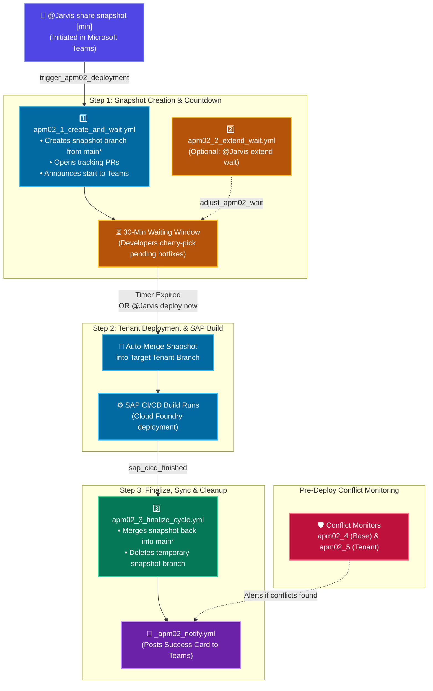
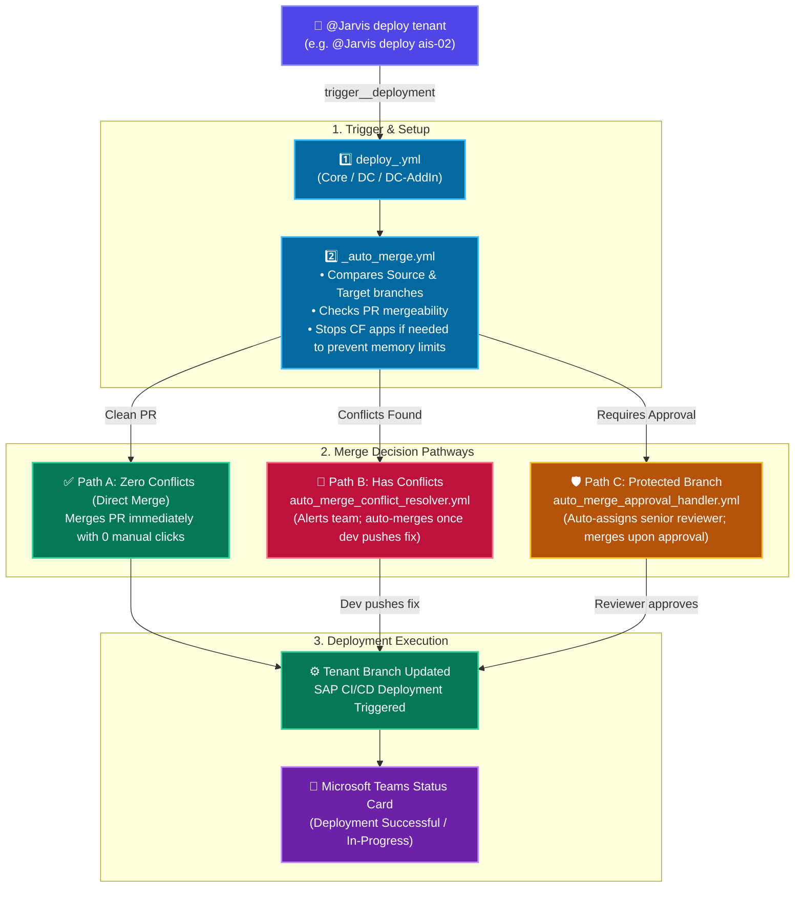

# AsInt Deployment Automation — Workflows Guide

This document lists all deployment workflows in the repository. For each workflow, it provides:
1. **File Name** (Clickable link to open the YAML file)
2. **What does it do?** (Clear, simple summary)
3. **When is it triggered?** (Exact YAML trigger code block directly from the file)
4. **Steps performed** (Clean numbered sequence)

---

## Section 1: APM-02 Deployment Family (Workflows 1 to 6)

### 1. [apm02_1_create_and_wait.yml](.github/workflows/apm02_1_create_and_wait.yml)
* **What does it do?**  
  Starts the APM-02 deployment cycle. It creates a snapshot branch from the base branch (`main`, `main-dc`, or `main-dc-addin`), creates tracking PRs, alerts the team on Microsoft Teams, and maintains a countdown waiting window (default 30–50 mins) so developers can cherry-pick pending commits before code freeze.
* **When is it triggered?**
  ```yaml
  on:
    repository_dispatch:
      types: 
        - trigger_apm02_deployment
        - trigger_apm02_dc_deployment
        - trigger_apm02_dc_addin_deployment
  ```
* **Steps performed:**
  1. Detects target environment configuration (`APM-02`, `APM-02 DC`, or `APM-02 DC AddIn`) and checks for blocked states.
  2. Creates and pushes the snapshot branch from base branch (`main`, `main-dc`, or `main-dc-addin`).
  3. Creates tracking PRs (into the tenant branch and tracking PR into base branch).
  4. Posts deployment announcement card to Microsoft Teams.
  5. Runs countdown polling loop for the specified waiting minutes.
  6. When the countdown completes (or bypassed via `@Jarvis deploy now`), merges the snapshot into the tenant branch to trigger the SAP CI/CD build.

---

### 2. [apm02_2_extend_wait.yml](.github/workflows/apm02_2_extend_wait.yml)
* **What does it do?**  
  Adjusts and extends the running countdown timer on an active APM-02 snapshot if developers need more time to complete cherry-picks.
* **When is it triggered?**
  ```yaml
  on:
    repository_dispatch:
      types: 
        - adjust_apm02_wait
        - adjust_apm02_dc_wait
        - adjust_apm02_dc_addin_wait
  ```
* **Steps performed:**
  1. Detects target environment (`APM-02`, `APM-02 DC`, or `APM-02 DC AddIn`).
  2. Verifies that an APM-02 snapshot is currently active.
  3. Updates the countdown timer with the requested minutes.
  4. Posts the updated countdown time to Microsoft Teams.

---

### 3. [apm02_3_finalize_cycle.yml](.github/workflows/apm02_3_finalize_cycle.yml)
* **What does it do?**  
  Finalizes the APM-02 deployment cycle after the SAP CI/CD build finishes. When the build succeeds, it merges the snapshot branch back into the base branch (`main`, `main-dc`, or `main-dc-addin`), sends completion notifications to Microsoft Teams, and deletes the temporary snapshot branch.
* **When is it triggered?**
  ```yaml
  on:
    repository_dispatch:
      types: [sap_cicd_finished]
  ```
* **Steps performed:**
  1. Validates the SAP CI/CD webhook payload and ensures tenant PR was merged.
  2. Checks for protected file changes (`mta.yaml`, `xs-security.json`).
  3. Merges the snapshot branch back into the base branch (`main`, `main-dc`, or `main-dc-addin`).
  4. Posts the deployment success status card to Microsoft Teams.
  5. Deletes the temporary snapshot branch from GitHub.

---

### 4. [apm02_4_conflict_monitor.yml](.github/workflows/apm02_4_conflict_monitor.yml)
* **What does it do?**  
  Continuously monitors Pull Requests targeting base branches (`main`, `main-dc`, `main-dc-addin`) to detect merge conflicts before deployment begins.
* **When is it triggered?**
  ```yaml
  on:
    pull_request:
      branches:
        - main
        - main-dc
        - main-dc-addin
      types: [synchronize, closed]
  ```
* **Steps performed:**
  1. Checks mergeability status of incoming PR against the base branch.
  2. If conflicts exist, alerts the team on Microsoft Teams with exact conflict details.
  3. If PR is closed, cleans up associated labels.

---

### 5. [apm02_5_apm02_conflict_monitor.yml](.github/workflows/apm02_5_apm02_conflict_monitor.yml)
* **What does it do?**  
  Continuously monitors Pull Requests targeting APM-02 tenant branches for merge conflicts.
* **When is it triggered?**
  ```yaml
  on:
    pull_request:
      branches:
        - "tenant/asint-apm-02-v2"
        - "tenant/asint-apm-02-dc"
        - "tenant/asint-apm-02-dc-addin"
      types: [synchronize, closed]
  ```
* **Steps performed:**
  1. Checks mergeability status of incoming PR against the tenant deployment branch.
  2. If conflicts are detected, flags the PR and sends notification to Microsoft Teams.

---

### 6. [apm02_6_recovery.yml](.github/workflows/apm02_6_recovery.yml)
* **What does it do?**  
  Rolls back, re-triggers, or redeploys snapshot fixes if a deployment step encounters errors or requires re-running.
* **When is it triggered?**
  ```yaml
  on:
    push:
      branches:
        - 'snapshot/main-*'
        - 'snapshot/main-dc-*'
        - 'snapshot/main-dc-addin-*'
    repository_dispatch:
      types: 
        - retrigger_apm02_deployment
        - redeploy_apm02_fix
        - retrigger_apm02_dc_deployment
        - redeploy_apm02_dc_fix
        - retrigger_apm02_dc_addin_deployment
        - redeploy_apm02_dc_addin_fix
  ```
* **Steps performed:**
  1. Identifies the snapshot branch and deployment target.
  2. Resets branch state or re-executes failed deployment steps.
  3. Cleans up labels and updates Microsoft Teams status.

---

## Section 2: Auto-Merge & Governance Workflows (Workflows 7 to 9)

### 7. [_auto_merge.yml](.github/workflows/_auto_merge.yml)
* **What does it do?**  
  Reusable core auto-merge engine called by tenant deployment workflows (e.g. merging `dev` into `tenant/asint-ais-02`). Checks for clean merge state, handles optional Cloud Foundry app stopping during deployments to avoid space/organization memory limits being exceeded, and automatically merges the PR without manual button clicks.
* **When is it triggered?**
  ```yaml
  on:
    workflow_call:
      inputs:
        base:
          required: true
          type: string
        compare:
          required: true
          type: string
        deployment_name:
          required: false
          type: string
        dashboard_url:
          required: false
          type: string
        cf_stop_app:
          required: false
          type: string
        cf_api:
          required: false
          type: string
        cf_org:
          required: false
          type: string
        cf_space:
          required: false
          type: string
        reviewers:
          required: false
          type: string
  ```
* **Steps performed:**
  1. Compares base branch with incoming compare branch (e.g. `dev`).
  2. If clean with no conflicts, creates and immediately merges the PR.
  3. If configured, stops Cloud Foundry apps during deployment to prevent organization or space memory exceed release fail issue.
  4. If merge conflicts exist, pauses, assigns labels, and alerts the team on Microsoft Teams.

---

### 8. [auto_merge_conflict_resolver.yml](.github/workflows/auto_merge_conflict_resolver.yml)
* **What does it do?**  
  Self-Healing Conflict Resolver: Listens for developer push events on PRs that previously had conflicts. Once a developer resolves the conflicts and pushes fixes, this workflow automatically detects the clean PR, merges it, and starts deployment.
* **When is it triggered?**
  ```yaml
  on:
    pull_request:
      branches:
        - "tenant/**"
        - "apm-eiot-temp-copy"
        - "st-env-for-contentfederation"
      types: [synchronize, closed]
  ```
* **Steps performed:**
  1. Checks if the newly pushed commit resolved all merge conflicts.
  2. Confirms that mergeability status is clean.
  3. Automatically merges the PR into the tenant branch.
  4. Resumes deployment and notifies Microsoft Teams.

---

### 9. [auto_merge_approval_handler.yml](.github/workflows/auto_merge_approval_handler.yml)
* **What does it do?**  
  Protected Branch Review & Governance: On protected branches where merge rules require review approval, this workflow auto-assigns senior reviewers. The moment an approval is submitted, it automatically merges the PR and proceeds with deployment.
* **When is it triggered?**
  ```yaml
  on:
    pull_request_review:
      types: [submitted]
    pull_request:
      branches:
        - "tenant/**"
        - "apm-eiot-temp-copy"
        - "st-env-for-contentfederation"
      types: [closed]
  ```
* **Steps performed:**
  1. Inspects submitted review to confirm it is `APPROVED`.
  2. Verifies branch protection rules are satisfied.
  3. Merges the PR into the protected branch.
  4. Triggers deployment notification on Microsoft Teams.

---

## Section 3: Helper & Webhook Workflows (Workflows 10 to 12)

### 10. [_apm02_notify.yml](.github/workflows/_apm02_notify.yml)
* **What does it do?**  
  Reusable Microsoft Teams notification helper that formats and posts structured visual status cards (Snapshot Created, Reminders, Merge Success, Conflicts).
* **When is it triggered?**
  ```yaml
  on:
    workflow_call:
      inputs:
        card_title:
          required: true
          type: string
        status_text:
          required: true
          type: string
        status_color:
          required: true
          type: string
  ```
* **Steps performed:**
  1. Receives notification inputs (title, status, environment, PR link).
  2. Constructs Microsoft Teams Adaptive Card JSON payload.
  3. Sends webhook POST request to the Microsoft Teams channel.

---

### 11. [sap_cicd_notifier.yml](.github/workflows/sap_cicd_notifier.yml)
* **What does it do?**  
  Listens for incoming SAP Continuous Integration & Delivery (ANS) webhook notifications and dispatches `sap_cicd_finished` to trigger the finalization workflow.
* **When is it triggered?**
  ```yaml
  on:
    repository_dispatch:
      types: [sap_cicd_started, sap_cicd_finished]
  ```
* **Steps performed:**
  1. Validates incoming SAP CI/CD webhook event payload.
  2. Dispatches `sap_cicd_finished` repository dispatch event to trigger `apm02_3_finalize_cycle.yml`.

---

### 12. [_cf_app_control.yml](.github/workflows/_cf_app_control.yml)
* **What does it do?**  
  Controls Cloud Foundry application states (stops, starts, or checks status of apps/approuters) during deployments to avoid Cloud Foundry space memory or organization memory limits from being exceeded.
* **When is it triggered?**
  ```yaml
  on:
    workflow_call:
      inputs:
        api_endpoint:
          required: false
          type: string
        org:
          required: false
          type: string
        space:
          required: false
          type: string
        app_name:
          required: true
          type: string
        action:
          required: true
          type: string # 'stop', 'start', or 'status'
  ```
* **Steps performed:**
  1. Logs into Cloud Foundry using deployment credentials.
  2. Executes target operation (`cf stop`, `cf start`, or `cf status`).
  3. Returns application status output.

---

## Section 4: Tenant Deployment Callers (42 Workflows)

* **What do they do?**  
  Each workflow triggers deployment for a specific tenant and module (Core, Data Conduit, or Add-In). It calls `_auto_merge.yml` with its designated **Compare Branch** (e.g. `main`, `dev`, or a QA branch) and **Target Tenant Branch** to automatically merge updates and trigger the SAP CI/CD build.
* **When are they triggered?**
  ```yaml
  on:
    repository_dispatch:
      types: [trigger_<environment>_deployment]
  ```
* **Steps performed:**
  1. Calls `_auto_merge.yml` with the tenant's specific `compare` branch and target `base` branch.
  2. Evaluates mergeability; if clean with no conflicts, creates and merges the PR automatically.
  3. Optionally stops configured Cloud Foundry apps to avoid exceeding space/org memory limits.
  4. Triggers the tenant's build in SAP CI/CD.

---

### Complete Tenant Branch Mapping Table

| Tenant Environment | Module | Workflow File | Compare Branch (Source) | Target Tenant Branch (Destination) |
| :--- | :--- | :--- | :--- | :--- |
| **AIS 02** | Core | [`merge_dev_to_tenant_ais02.yml`](.github/workflows/merge_dev_to_tenant_ais02.yml) | `dev` | `tenant/asint-ais-02` |
| | DC | [`deploy_ais02_dc.yml`](.github/workflows/deploy_ais02_dc.yml) | `dev` | `tenant/asint-ais-02-dc` |
| | DC AddIn | [`deploy_ais02_dc_addin.yml`](.github/workflows/deploy_ais02_dc_addin.yml) | `dev` | `tenant/asint-ais-02-dc-addin` |
| **APM 01** | Core | [`deploy_apm01.yml`](.github/workflows/deploy_apm01.yml) | `main` | `tenant/asint-apm-01-new` |
| | DC | [`deploy_apm01_dc.yml`](.github/workflows/deploy_apm01_dc.yml) | `main-dc` | `tenant/asint-apm-01-dc` |
| | DC AddIn | [`deploy_apm01_dc_addin.yml`](.github/workflows/deploy_apm01_dc_addin.yml) | `main-dc-addin` | `tenant/asint-apm-01-dc-addin` |
| **APM EIOT** | Core | [`deploy_apm_eiot.yml`](.github/workflows/deploy_apm_eiot.yml) | `main` | `apm-eiot-temp-copy` |
| | DC | [`deploy_apm_eiot_dc.yml`](.github/workflows/deploy_apm_eiot_dc.yml) | `main-dc` | `tenant/asint-apm-eiot-dc` |
| | DC AddIn | [`deploy_apm_eiot_dc_addin.yml`](.github/workflows/deploy_apm_eiot_dc_addin.yml) | `main-dc-addin` | `tenant/asint-apm-eiot-dc-addin` |
| **AsInt Demo** | Core | [`deploy_asint_demo.yml`](.github/workflows/deploy_asint_demo.yml) | `main` | `tenant/asint-demo` |
| | DC | [`deploy_asint_demo_dc.yml`](.github/workflows/deploy_asint_demo_dc.yml) | `main-dc` | `tenant/asint-demo-dc` |
| | DC AddIn | [`deploy_asint_demo_dc_addin.yml`](.github/workflows/deploy_asint_demo_dc_addin.yml) | `main-dc-addin` | `tenant/asint-demo-dc-addin` |
| **Baystar** | Core | [`deploy_baystar.yml`](.github/workflows/deploy_baystar.yml) | `main` | `tenant/baystar` |
| | DC | [`deploy_baystar_dc.yml`](.github/workflows/deploy_baystar_dc.yml) | `main-dc` | `tenant/baystar-dc` |
| | DC AddIn | [`deploy_baystar_dc_addin.yml`](.github/workflows/deploy_baystar_dc_addin.yml) | `main-dc-addin` | `tenant/baystar-dc-addin` |
| **HSC Non-Prod** | Core | [`deploy_hsc_non_prod.yml`](.github/workflows/deploy_hsc_non_prod.yml) | `main` | `tenant/hemlock-non-prod` |
| | DC | [`deploy_hsc_non_prod_dc.yml`](.github/workflows/deploy_hsc_non_prod_dc.yml) | `main-dc` | `tenant/hemlock-non-prod-dc` |
| | DC AddIn | [`deploy_hsc_non_prod_dc_addin.yml`](.github/workflows/deploy_hsc_non_prod_dc_addin.yml) | `main-dc-addin` | `tenant/hemlock-non-prod-dc-addin` |
| **HSC Prod** | Core | [`deploy_hsc_prod.yml`](.github/workflows/deploy_hsc_prod.yml) | `tenant/hemlock-non-prod` | `tenant/hemlock-prod` |
| | DC | [`deploy_hsc_prod_dc.yml`](.github/workflows/deploy_hsc_prod_dc.yml) | `tenant/hemlock-non-prod-dc` | `tenant/hemlock-prod-dc` |
| | DC AddIn | [`deploy_hsc_prod_dc_addin.yml`](.github/workflows/deploy_hsc_prod_dc_addin.yml) | `tenant/hemlock-non-prod-dc-addin` | `tenant/hemlock-prod-dc-addin` |
| **Indorama QA 233** | Core | [`deploy_indorama_qa_233.yml`](.github/workflows/deploy_indorama_qa_233.yml) | `main` | `tenant/indorama-qa-233` |
| | DC | [`deploy_indorama_qa_233_dc.yml`](.github/workflows/deploy_indorama_qa_233_dc.yml) | `main-dc` | `tenant/indorama-qa-233-dc` |
| | DC AddIn | [`deploy_indorama_qa_233_dc_addin.yml`](.github/workflows/deploy_indorama_qa_233_dc_addin.yml) | `main-dc-addin` | `tenant/indorama-qa-233-dc-addin` |
| **Indorama Prod 900** | Core | [`deploy_indorama_prod_900.yml`](.github/workflows/deploy_indorama_prod_900.yml) | `tenant/indorama-qa-233` | `tenant/indorama-prod-900` |
| | DC | [`deploy_indorama_prod_900_dc.yml`](.github/workflows/deploy_indorama_prod_900_dc.yml) | `tenant/indorama-qa-233-dc` | `tenant/indorama-prod-900-dc` |
| | DC AddIn | [`deploy_indorama_prod_900_dc_addin.yml`](.github/workflows/deploy_indorama_prod_900_dc_addin.yml) | `tenant/indorama-qa-233-dc-addin` | `tenant/indorama-prod-900-dc-addin` |
| **Indorama QA 234** | Core | [`deploy_indorama_qa_234.yml`](.github/workflows/deploy_indorama_qa_234.yml) | `main` | `tenant/indorama-qa-234` |
| | DC | [`deploy_indorama_qa_234_dc.yml`](.github/workflows/deploy_indorama_qa_234_dc.yml) | `main-dc` | `tenant/indorama-qa-234-dc` |
| | DC AddIn | [`deploy_indorama_qa_234_dc_addin.yml`](.github/workflows/deploy_indorama_qa_234_dc_addin.yml) | `main-dc-addin` | `tenant/indorama-qa-234-dc-addin` |
| **Indorama Prod 933** | Core | [`deploy_indorama_prod_933.yml`](.github/workflows/deploy_indorama_prod_933.yml) | `tenant/indorama-qa-234` | `tenant/indorama-prod-933` |
| | DC | [`deploy_indorama_prod_933_dc.yml`](.github/workflows/deploy_indorama_prod_933_dc.yml) | `tenant/indorama-qa-234-dc` | `tenant/indorama-prod-933-dc` |
| | DC AddIn | [`deploy_indorama_prod_933_dc_addin.yml`](.github/workflows/deploy_indorama_prod_933_dc_addin.yml) | `tenant/indorama-qa-234-dc-addin` | `tenant/indorama-prod-933-dc-addin` |
| **IRC** | Core | [`deploy_irc.yml`](.github/workflows/deploy_irc.yml) | `main` | `tenant/asint-irc-temp` |
| | DC | [`deploy_irc_dc.yml`](.github/workflows/deploy_irc_dc.yml) | `main-dc` | `tenant/irc-dc` |
| | DC AddIn | [`deploy_irc_dc_addin.yml`](.github/workflows/deploy_irc_dc_addin.yml) | `main-dc-addin` | `tenant/irc-dc-addin` |
| **ST Env** | Core | [`deploy_st_env.yml`](.github/workflows/deploy_st_env.yml) | `dev` | `st-env-for-contentfederation` |
| | DC | [`deploy_st_env_dc.yml`](.github/workflows/deploy_st_env_dc.yml) | `dev` | `tenant/asint-st-env-dc` |
| | DC AddIn | [`deploy_st_env_dc_addin.yml`](.github/workflows/deploy_st_env_dc_addin.yml) | `dev` | `tenant/asint-st-env-dc-addin` |
| **VMOS** | Core | [`deploy_vmos.yml`](.github/workflows/deploy_vmos.yml) | `main` | `tenant/vmos-dev` |
| | DC | [`deploy_vmos_dc.yml`](.github/workflows/deploy_vmos_dc.yml) | `main-dc` | `tenant/vmos-dc` |
| | DC AddIn | [`deploy_vmos_dc_addin.yml`](.github/workflows/deploy_vmos_dc_addin.yml) | `main-dc-addin` | `tenant/vmos-dc-addin` |

---

## 🔗 End-to-End Workflow Connectivity Flows

### 📦 1. APM-02 Release Lifecycle Flow
Shows the scheduled snapshot creation from `main*`, the 30-minute cherry-pick countdown window, building via tenant branch, and final sync back into `main*`:



---

### ⚡ 2. Direct Auto-Merge Deployment Flow (Tenant Callers)
Shows how tenant deployments (AIS-02, APM-01, Baystar, etc.) are executed via direct auto-merge, self-healing conflict resolution, and reviewer approvals:



