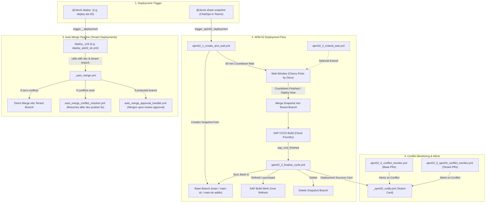

# AsInt Deployment Automation — Workflows Guide

This document lists all deployment workflows in the repository. For each workflow, it provides:
1. **File Name** (Clickable link to open the YAML file)
2. **What does it do?** (Accurate technical explanation)
3. **When is it triggered?** (Exact YAML event trigger code block)
4. **Steps performed** (Clean numbered sequence)

---

## Section 1: APM-02 Deployment Family (Workflows 1 to 6)

### 1. [apm02_1_create_and_wait.yml](.github/workflows/apm02_1_create_and_wait.yml)
* **What does it do?**  
  Starts the APM-02 deployment cycle. It creates a snapshot branch **from the base branch (`main`, `main-dc`, or `main-dc-addin`)**, creates a tracking PR into the tenant branch, announces deployment start on Microsoft Teams, and maintains a countdown wait window (default 30–50 mins) allowing developers to cherry-pick pending commits before code freeze.
* **When is it triggered?**
  ```yaml
  on:
    repository_dispatch:
      types: 
        - trigger_apm02_deployment
        - trigger_apm02_dc_deployment
        - trigger_apm02_dc_addin_deployment
  ```
* **Steps performed:**
  1. Detects target environment configuration (`APM-02`, `APM-02 DC`, or `APM-02 DC AddIn`) and verifies no deployment is currently blocked.
  2. Creates and pushes the snapshot branch from base branch (`main` / `main-dc` / `main-dc-addin`).
  3. Creates tracking PRs (one into the tenant branch and one tracking PR into the base branch).
  4. Sends initial deployment announcement card to Microsoft Teams.
  5. Enters countdown polling loop for the specified waiting minutes.
  6. When countdown finishes (or if bypassed via `@Jarvis deploy now`), merges the snapshot into the tenant branch to trigger the SAP CI/CD build.

---

### 2. [apm02_2_extend_wait.yml](.github/workflows/apm02_2_extend_wait.yml)
* **What does it do?**  
  Dynamically extends the running countdown timer on an active APM-02 snapshot if developers need additional time to complete cherry-picks.
* **When is it triggered?**
  ```yaml
  on:
    repository_dispatch:
      types: [extend_apm02_wait]
  ```
* **Steps performed:**
  1. Verifies that an APM-02 snapshot is currently in the active countdown state.
  2. Increments the waiting timer with the newly requested minutes.
  3. Updates the Microsoft Teams notification card with the new remaining countdown.

---

### 3. [apm02_3_finalize_cycle.yml](.github/workflows/apm02_3_finalize_cycle.yml)
* **What does it do?**  
  Finalizes the APM-02 deployment cycle after the SAP CI/CD build finishes. Once SAP deployment succeeds, **it merges the snapshot branch back into the base branch (`main`, `main-dc`, or `main-dc-addin`)**, triggers the SAP Build Work Zone (BWZ) Launchpad content channel refresh, and cleans up the snapshot branch.
* **When is it triggered?**
  ```yaml
  on:
    repository_dispatch:
      types: [sap_cicd_finished]
  ```
* **Steps performed:**
  1. Validates the incoming SAP CI/CD webhook payload and checks that the tenant deployment completed.
  2. Checks for protected file changes (`mta.yaml`, `xs-security.json`).
  3. **Merges the snapshot branch back into the base branch (`main` / `main-dc` / `main-dc-addin`)**.
  4. Executes headless Playwright automation script to refresh the SAP Build Work Zone content channel.
  5. Broadcasts the final deployment success card to Microsoft Teams.
  6. Deletes the temporary snapshot branch from GitHub.

---

### 4. [apm02_4_conflict_monitor.yml](.github/workflows/apm02_4_conflict_monitor.yml)
* **What does it do?**  
  Continuously monitors open Pull Requests targeting base branches (`main`, `main-dc`, `main-dc-addin`) to detect merge conflicts before deployment initiates.
* **When is it triggered?**
  ```yaml
  on:
    pull_request:
      types: [opened, synchronize, reopened]
      branches:
        - main
        - main-dc
        - main-dc-addin
  ```
* **Steps performed:**
  1. Checks mergeability status of incoming PR against the base branch.
  2. If conflicting files exist, alerts the team on Microsoft Teams with exact conflict details.

---

### 5. [apm02_5_apm02_conflict_monitor.yml](.github/workflows/apm02_5_apm02_conflict_monitor.yml)
* **What does it do?**  
  Continuously monitors open Pull Requests targeting APM-02 tenant branches (`tenant/asint-apm-02-v2`, `tenant/asint-apm-02-dc`, `tenant/asint-apm-02-dc-addin`) to detect merge conflicts.
* **When is it triggered?**
  ```yaml
  on:
    pull_request:
      types: [opened, synchronize, reopened]
      branches:
        - "tenant/asint-apm-02-v2"
        - "tenant/asint-apm-02-dc"
        - "tenant/asint-apm-02-dc-addin"
  ```
* **Steps performed:**
  1. Checks mergeability status of incoming PR against the tenant deployment branch.
  2. If conflicts are detected, flags the PR and alerts the team on Microsoft Teams.

---

### 6. [apm02_6_recovery.yml](.github/workflows/apm02_6_recovery.yml)
* **What does it do?**  
  Emergency rollback and recovery workflow that restores branches to their safe baseline commit if any deployment step fails midway.
* **When is it triggered?**
  ```yaml
  on:
    workflow_dispatch:
    repository_dispatch:
      types: [recover_apm02_deployment]
  ```
* **Steps performed:**
  1. Identifies failed deployment run and associated snapshot branch.
  2. Resets branch pointers to pre-deployment baseline commits.
  3. Removes failed labels and unlocks deployment guards.
  4. Posts recovery status card to Microsoft Teams.

---

## Section 2: Intelligent Auto-Merge & Governance Engine (Workflows 7 to 9)

### 7. [_auto_merge.yml](.github/workflows/_auto_merge.yml)
* **What does it do?**  
  Reusable core auto-merge engine used by tenant deployment callers (e.g. merging `dev` into `tenant/asint-ais-02`). Checks for clean merge state, handles optional Cloud Foundry app stopping during database changes, and automatically merges the PR without manual button clicks.
* **When is it triggered?**
  ```yaml
  on:
    workflow_call:
      inputs:
        base:
          required: true
          type: string
        compare:
          required: true
          type: string
        deployment_name:
          required: false
          type: string
  ```
* **Steps performed:**
  1. Checks if diff exists between compare branch (e.g. `dev`) and base branch (e.g. `tenant/asint-ais-02`).
  2. If clean with no conflicts, creates and immediately merges PR.
  3. Optionally stops specified Cloud Foundry apps during migration if configured.
  4. If merge conflicts exist, pauses, assigns labels, and alerts developers on Microsoft Teams.

---

### 8. [auto_merge_conflict_resolver.yml](.github/workflows/auto_merge_conflict_resolver.yml)
* **What does it do?**  
  Self-Healing Conflict Resolver: Listens for developer push events on PRs that previously had conflicts. Once a developer resolves the conflicts and pushes fixes, this workflow automatically detects the clean PR, merges it, and resumes deployment.
* **When is it triggered?**
  ```yaml
  on:
    pull_request:
      types: [synchronize]
      branches:
        - "tenant/**"
        - "apm-eiot-temp-copy"
        - "st-env-for-contentfederation"
  ```
* **Steps performed:**
  1. Checks if incoming commit resolved the conflicting files.
  2. Verifies mergeability status becomes clean.
  3. Automatically merges the PR into the target tenant branch.
  4. Resumes deployment and notifies Microsoft Teams.

---

### 9. [auto_merge_approval_handler.yml](.github/workflows/auto_merge_approval_handler.yml)
* **What does it do?**  
  Protected Branch Review & Governance: On protected branches where merge rules require review approval, this workflow auto-assigns senior reviewers. The moment an approval is submitted, it automatically merges the PR and proceeds with deployment.
* **When is it triggered?**
  ```yaml
  on:
    pull_request_review:
      types: [submitted]
  ```
* **Steps performed:**
  1. Inspects submitted review state to confirm it is `APPROVED`.
  2. Verifies all branch protection rules are satisfied.
  3. Merges the PR into the protected branch.
  4. Triggers the deployment notification to Microsoft Teams.

---

## Section 3: Helper & Webhook Workflows (Workflows 10 to 12)

### 10. [_apm02_notify.yml](.github/workflows/_apm02_notify.yml)
* **What does it do?**  
  Centralized Microsoft Teams Adaptive Card notifier that formats and posts visual status cards (Snapshot Created, Reminders, Merge Success, Conflicts).
* **When is it triggered?**
  ```yaml
  on:
    workflow_call:
      inputs: ...
    repository_dispatch:
      types: [apm02_notify]
  ```
* **Steps performed:**
  1. Extracts incoming notification inputs (title, status, environment, PR link).
  2. Formats adaptive card payload.
  3. Dispatches HTTP POST to Microsoft Teams webhook.

---

### 11. [sap_cicd_notifier.yml](.github/workflows/sap_cicd_notifier.yml)
* **What does it do?**  
  Listens for incoming SAP Continuous Integration & Delivery (ANS) webhook notifications and dispatches `sap_cicd_finished` to trigger the finalization workflow.
* **When is it triggered?**
  ```yaml
  on:
    repository_dispatch:
      types: [sap_cicd_alert]
  ```
* **Steps performed:**
  1. Validates SAP CI/CD webhook event payload.
  2. Dispatches `sap_cicd_finished` to trigger `apm02_3_finalize_cycle.yml`.

---

### 12. [_cf_app_control.yml](.github/workflows/_cf_app_control.yml)
* **What does it do?**  
  Controls Cloud Foundry application states (stops, starts, or restarts apps/approuters) during deployments to avoid database lockups.
* **When is it triggered?**
  ```yaml
  on:
    workflow_call:
      inputs:
        action:
          required: true
          type: string
        app_name:
          required: true
          type: string
  ```
* **Steps performed:**
  1. Authenticates with Cloud Foundry CLI.
  2. Executes target operation (`cf stop`, `cf start`, or `cf restart`).
  3. Verifies application state.

---

## Section 4: Tenant Deployment Callers (`deploy_*.yml` — 43 Workflows)

* **What do they do?**  
  Each workflow targets a specific tenant environment (e.g. `tenant/asint-ais-02`, `tenant/asint-apm-01`, `tenant/asint-baystar`). It calls `_auto_merge.yml` to merge `dev` into the tenant branch, which automatically kicks off SAP CI/CD deployment.
* **When are they triggered?**
  ```yaml
  on:
    repository_dispatch:
      types: [trigger_<tenant>_deployment]
    workflow_dispatch:
  ```
* **Steps performed:**
  1. Calls `_auto_merge.yml` with the tenant's base branch and `dev` as compare branch.
  2. Checks for conflicts; merges clean commits.
  3. Kicks off SAP CI/CD build for that tenant.

### Tenant Workflows Directory:
* **AIS 02:** [`deploy_ais02_dc.yml`](.github/workflows/deploy_ais02_dc.yml), [`deploy_ais02_dc_addin.yml`](.github/workflows/deploy_ais02_dc_addin.yml), [`merge_dev_to_tenant_ais02.yml`](.github/workflows/merge_dev_to_tenant_ais02.yml)
* **APM 01:** [`deploy_apm01.yml`](.github/workflows/deploy_apm01.yml), [`deploy_apm01_dc.yml`](.github/workflows/deploy_apm01_dc.yml), [`deploy_apm01_dc_addin.yml`](.github/workflows/deploy_apm01_dc_addin.yml)
* **APM EIOT:** [`deploy_apm_eiot.yml`](.github/workflows/deploy_apm_eiot.yml), [`deploy_apm_eiot_dc.yml`](.github/workflows/deploy_apm_eiot_dc.yml), [`deploy_apm_eiot_dc_addin.yml`](.github/workflows/deploy_apm_eiot_dc_addin.yml)
* **AsInt Demo:** [`deploy_asint_demo.yml`](.github/workflows/deploy_asint_demo.yml), [`deploy_asint_demo_dc.yml`](.github/workflows/deploy_asint_demo_dc.yml), [`deploy_asint_demo_dc_addin.yml`](.github/workflows/deploy_asint_demo_dc_addin.yml)
* **Baystar:** [`deploy_baystar.yml`](.github/workflows/deploy_baystar.yml), [`deploy_baystar_dc.yml`](.github/workflows/deploy_baystar_dc.yml), [`deploy_baystar_dc_addin.yml`](.github/workflows/deploy_baystar_dc_addin.yml)
* **HSC Non-Prod & Prod:** [`deploy_hsc_non_prod.yml`](.github/workflows/deploy_hsc_non_prod.yml), [`deploy_hsc_non_prod_dc.yml`](.github/workflows/deploy_hsc_non_prod_dc.yml), [`deploy_hsc_non_prod_dc_addin.yml`](.github/workflows/deploy_hsc_non_prod_dc_addin.yml), [`deploy_hsc_prod.yml`](.github/workflows/deploy_hsc_prod.yml), [`deploy_hsc_prod_dc.yml`](.github/workflows/deploy_hsc_prod_dc.yml), [`deploy_hsc_prod_dc_addin.yml`](.github/workflows/deploy_hsc_prod_dc_addin.yml)
* **Indorama Prod (900 & 933):** [`deploy_indorama_prod_900.yml`](.github/workflows/deploy_indorama_prod_900.yml), [`deploy_indorama_prod_900_dc.yml`](.github/workflows/deploy_indorama_prod_900_dc.yml), [`deploy_indorama_prod_900_dc_addin.yml`](.github/workflows/deploy_indorama_prod_900_dc_addin.yml), [`deploy_indorama_prod_933.yml`](.github/workflows/deploy_indorama_prod_933.yml), [`deploy_indorama_prod_933_dc.yml`](.github/workflows/deploy_indorama_prod_933_dc.yml), [`deploy_indorama_prod_933_dc_addin.yml`](.github/workflows/deploy_indorama_prod_933_dc_addin.yml)
* **Indorama QA (233 & 234):** [`deploy_indorama_qa_233.yml`](.github/workflows/deploy_indorama_qa_233.yml), [`deploy_indorama_qa_233_dc.yml`](.github/workflows/deploy_indorama_qa_233_dc.yml), [`deploy_indorama_qa_233_dc_addin.yml`](.github/workflows/deploy_indorama_qa_233_dc_addin.yml), [`deploy_indorama_qa_234.yml`](.github/workflows/deploy_indorama_qa_234.yml), [`deploy_indorama_qa_234_dc.yml`](.github/workflows/deploy_indorama_qa_234_dc.yml), [`deploy_indorama_qa_234_dc_addin.yml`](.github/workflows/deploy_indorama_qa_234_dc_addin.yml)
* **IRC:** [`deploy_irc.yml`](.github/workflows/deploy_irc.yml), [`deploy_irc_dc.yml`](.github/workflows/deploy_irc_dc.yml), [`deploy_irc_dc_addin.yml`](.github/workflows/deploy_irc_dc_addin.yml)
* **ST Env:** [`deploy_st_env.yml`](.github/workflows/deploy_st_env.yml), [`deploy_st_env_dc.yml`](.github/workflows/deploy_st_env_dc.yml), [`deploy_st_env_dc_addin.yml`](.github/workflows/deploy_st_env_dc_addin.yml)
* **VMOS:** [`deploy_vmos.yml`](.github/workflows/deploy_vmos.yml), [`deploy_vmos_dc.yml`](.github/workflows/deploy_vmos_dc.yml), [`deploy_vmos_dc_addin.yml`](.github/workflows/deploy_vmos_dc_addin.yml)

---

## 🔗 End-to-End Workflow Connectivity Diagram


