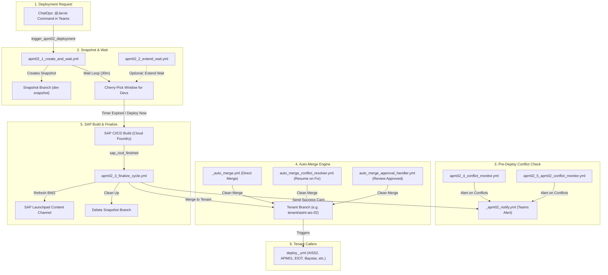

# AsInt Deployment Automation — Workflows Guide

This document lists all deployment workflows in the repository. For each workflow, it explains:
1. **What does it do?**
2. **When is it triggered?** (Trigger code snippet)
3. **Steps performed** (Simple sequence of actions)

---

## Section 1: APM-02 Deployment Workflows

### 1. [apm02_1_create_and_wait.yml](https://github.com/Daxesh-Asint/asint-deployment-workflows/blob/main/.github/workflows/apm02_1_create_and_wait.yml)
* **What does it do?**  
  Starts the APM-02 deployment by creating a snapshot branch from `dev`, alerting the team on Microsoft Teams, and running a 30-minute waiting countdown so developers can cherry-pick any last-minute commits before code freeze.
* **When is it triggered?**
  ```yaml
  on:
    repository_dispatch:
      types: [trigger_apm02_deployment]
  ```
* **Steps performed:**
  1. Checks deployment guard conditions.
  2. Creates and pushes the snapshot branch from `dev`.
  3. Sends initial deployment announcement card to Microsoft Teams.
  4. Runs countdown wait loop (default: 30 minutes).
  5. Automatically triggers Step 3 (finalize) once the timer finishes.

---

### 2. [apm02_2_extend_wait.yml](https://github.com/Daxesh-Asint/asint-deployment-workflows/blob/main/.github/workflows/apm02_2_extend_wait.yml)
* **What does it do?**  
  Extends the snapshot countdown timer if developers need more time to cherry-pick or test fixes.
* **When is it triggered?**
  ```yaml
  on:
    repository_dispatch:
      types: [extend_apm02_wait]
  ```
* **Steps performed:**
  1. Validates that a snapshot deployment is currently active.
  2. Updates the countdown timer with the requested extra minutes.
  3. Posts an updated status card to Microsoft Teams.

---

### 3. [apm02_3_finalize_cycle.yml](https://github.com/Daxesh-Asint/asint-deployment-workflows/blob/main/.github/workflows/apm02_3_finalize_cycle.yml)
* **What does it do?**  
  Finalizes the deployment after SAP build completes. It merges the snapshot into the tenant branch, refreshes SAP Build Work Zone (Launchpad) content channels, and notifies the team.
* **When is it triggered?**
  ```yaml
  on:
    repository_dispatch:
      types: [sap_cicd_finished]
  ```
* **Steps performed:**
  1. Checks guard status and validates SAP build results.
  2. Merges the snapshot branch into the tenant deployment branch.
  3. Runs headless browser script to refresh SAP Build Work Zone content channel.
  4. Sends final deployment success card to Microsoft Teams.
  5. Deletes the temporary snapshot branch.

---

### 4. [apm02_4_conflict_monitor.yml](https://github.com/Daxesh-Asint/asint-deployment-workflows/blob/main/.github/workflows/apm02_4_conflict_monitor.yml)
* **What does it do?**  
  Checks open Pull Requests targeting base branches (`main`, `main-dc`, `main-dc-addin`) to see if merge conflicts exist before deployment begins.
* **When is it triggered?**
  ```yaml
  on:
    pull_request:
      types: [opened, synchronize, reopened]
      branches:
        - main
        - main-dc
        - main-dc-addin
  ```
* **Steps performed:**
  1. Compares incoming PR branch with the base branch.
  2. Detects any conflicting files.
  3. Sends conflict alert to Microsoft Teams if merge conflicts are found.

---

### 5. [apm02_5_apm02_conflict_monitor.yml](https://github.com/Daxesh-Asint/asint-deployment-workflows/blob/main/.github/workflows/apm02_5_apm02_conflict_monitor.yml)
* **What does it do?**  
  Checks open Pull Requests targeting APM-02 tenant branches for merge conflicts.
* **When is it triggered?**
  ```yaml
  on:
    pull_request:
      types: [opened, synchronize, reopened]
      branches:
        - "tenant/asint-apm-02-v2"
        - "tenant/asint-apm-02-dc"
        - "tenant/asint-apm-02-dc-addin"
  ```
* **Steps performed:**
  1. Inspects PR mergeability against tenant deployment branches.
  2. Flags any conflicting files.
  3. Sends notification to Microsoft Teams if conflicts are detected.

---

### 6. [apm02_6_recovery.yml](https://github.com/Daxesh-Asint/asint-deployment-workflows/blob/main/.github/workflows/apm02_6_recovery.yml)
* **What does it do?**  
  Rolls back and recovers the repository if a deployment step fails midway, restoring branches to their clean baseline state.
* **When is it triggered?**
  ```yaml
  on:
    workflow_dispatch:
    repository_dispatch:
      types: [recover_apm02_deployment]
  ```
* **Steps performed:**
  1. Identifies the failed deployment run and snapshot branch.
  2. Resets branch pointers back to the safe commit prior to snapshot.
  3. Cleans up temporary deployment branches and unlocks pipeline guards.
  4. Posts recovery notice to Microsoft Teams.

---

## Section 2: Auto-Merge & Governance Workflows

### 7. [_auto_merge.yml](https://github.com/Daxesh-Asint/asint-deployment-workflows/blob/main/.github/workflows/_auto_merge.yml)
* **What does it do?**  
  Direct Auto-Merge (Happy Path): Automatically merges deployment PRs (e.g. from `dev` to `tenant/asint-ais-02`) when there are no merge conflicts, starting deployment without any manual button clicks.
* **When is it triggered?**
  ```yaml
  on:
    pull_request:
      types: [opened, synchronize]
  ```
* **Steps performed:**
  1. Evaluates PR mergeability and checks for zero conflicts.
  2. Verifies that all required automated checks have passed.
  3. Automatically merges the PR into the target deployment branch.
  4. Triggers the tenant deployment workflow.

---

### 8. [auto_merge_conflict_resolver.yml](https://github.com/Daxesh-Asint/asint-deployment-workflows/blob/main/.github/workflows/auto_merge_conflict_resolver.yml)
* **What does it do?**  
  Self-Healing Conflict Resolver: When merge conflicts exist on a PR, it pauses and notifies the team. As soon as a developer resolves the conflicts and pushes fixes, this workflow automatically detects the clean PR, merges it, and starts deployment.
* **When is it triggered?**
  ```yaml
  on:
    pull_request:
      types: [synchronize]
  ```
* **Steps performed:**
  1. Checks if the newly pushed commit resolved all merge conflicts.
  2. If clean, automatically performs the merge.
  3. Triggers the deployment workflow with zero manual intervention.

---

### 9. [auto_merge_approval_handler.yml](https://github.com/Daxesh-Asint/asint-deployment-workflows/blob/main/.github/workflows/auto_merge_approval_handler.yml)
* **What does it do?**  
  Protected Branch Review Handler: For protected branches where merge rules require review, this workflow auto-assigns senior reviewers. The moment an approval is submitted, it automatically merges the PR and starts deployment.
* **When is it triggered?**
  ```yaml
  on:
    pull_request_review:
      types: [submitted]
  ```
* **Steps performed:**
  1. Checks if the submitted review is an `APPROVED` state.
  2. Confirms all branch protection requirements are met.
  3. Automatically merges the PR into the protected branch.
  4. Kicks off the deployment.

---

## Section 3: Helper & Integration Workflows

### 10. [_apm02_notify.yml](https://github.com/Daxesh-Asint/asint-deployment-workflows/blob/main/.github/workflows/_apm02_notify.yml)
* **What does it do?**  
  Formats and posts structured Microsoft Teams Adaptive Cards for deployment updates (Snapshot Created, Reminders, Merge Success, Conflicts).
* **When is it triggered?**
  ```yaml
  on:
    workflow_call:
      inputs: ...
    repository_dispatch:
      types: [apm02_notify]
  ```
* **Steps performed:**
  1. Parses incoming notification payload (title, status, environment).
  2. Constructs Microsoft Teams Adaptive Card JSON.
  3. Sends card via webhook to Microsoft Teams channel.

---

### 11. [sap_cicd_notifier.yml](https://github.com/Daxesh-Asint/asint-deployment-workflows/blob/main/.github/workflows/sap_cicd_notifier.yml)
* **What does it do?**  
  Receives build completion webhook alerts from SAP CI/CD and triggers the finalize deployment workflow.
* **When is it triggered?**
  ```yaml
  on:
    repository_dispatch:
      types: [sap_cicd_alert]
  ```
* **Steps performed:**
  1. Validates SAP CI/CD webhook event payload.
  2. Dispatches `sap_cicd_finished` event to trigger `apm02_3_finalize_cycle.yml`.

---

### 12. [_cf_app_control.yml](https://github.com/Daxesh-Asint/asint-deployment-workflows/blob/main/.github/workflows/_cf_app_control.yml)
* **What does it do?**  
  Starts, stops, or restarts SAP Cloud Foundry approuters/services during database binding and deployments.
* **When is it triggered?**
  ```yaml
  on:
    workflow_call:
      inputs:
        action: ...
        app_name: ...
  ```
* **Steps performed:**
  1. Logs into Cloud Foundry using deployment credentials.
  2. Executes target action (`stop`, `start`, or `restart`) on the specified app.
  3. Confirms application health state.

---

## Section 4: Tenant Deployment Caller Workflows (43 Workflows)

These workflows trigger deployments for each tenant environment. Each tenant has dedicated callers for **Core**, **Data Collector (DC)**, and **DC-AddIn**:

* **What do they do?**  
  Each workflow targets a specific tenant branch (e.g. `tenant/asint-apm-01`, `tenant/asint-ais-02`), checks out code, and initiates the tenant deployment pipeline.
* **When are they triggered?**
  ```yaml
  on:
    repository_dispatch:
      types: [deploy_<tenant_name>]
    workflow_dispatch:
  ```
* **Steps performed:**
  1. Checks out repository branch for the specific tenant.
  2. Sets up environment variables and tenant configuration.
  3. Executes the deployment package.
  4. Sends status result to Microsoft Teams.

### List of Tenant Caller Files:
* **AIS 02:** [`deploy_ais02_dc.yml`](https://github.com/Daxesh-Asint/asint-deployment-workflows/blob/main/.github/workflows/deploy_ais02_dc.yml), [`deploy_ais02_dc_addin.yml`](https://github.com/Daxesh-Asint/asint-deployment-workflows/blob/main/.github/workflows/deploy_ais02_dc_addin.yml), [`merge_dev_to_tenant_ais02.yml`](https://github.com/Daxesh-Asint/asint-deployment-workflows/blob/main/.github/workflows/merge_dev_to_tenant_ais02.yml)
* **APM 01:** [`deploy_apm01.yml`](https://github.com/Daxesh-Asint/asint-deployment-workflows/blob/main/.github/workflows/deploy_apm01.yml), [`deploy_apm01_dc.yml`](https://github.com/Daxesh-Asint/asint-deployment-workflows/blob/main/.github/workflows/deploy_apm01_dc.yml), [`deploy_apm01_dc_addin.yml`](https://github.com/Daxesh-Asint/asint-deployment-workflows/blob/main/.github/workflows/deploy_apm01_dc_addin.yml)
* **APM EIOT:** [`deploy_apm_eiot.yml`](https://github.com/Daxesh-Asint/asint-deployment-workflows/blob/main/.github/workflows/deploy_apm_eiot.yml), [`deploy_apm_eiot_dc.yml`](https://github.com/Daxesh-Asint/asint-deployment-workflows/blob/main/.github/workflows/deploy_apm_eiot_dc.yml), [`deploy_apm_eiot_dc_addin.yml`](https://github.com/Daxesh-Asint/asint-deployment-workflows/blob/main/.github/workflows/deploy_apm_eiot_dc_addin.yml)
* **AsInt Demo:** [`deploy_asint_demo.yml`](https://github.com/Daxesh-Asint/asint-deployment-workflows/blob/main/.github/workflows/deploy_asint_demo.yml), [`deploy_asint_demo_dc.yml`](https://github.com/Daxesh-Asint/asint-deployment-workflows/blob/main/.github/workflows/deploy_asint_demo_dc.yml), [`deploy_asint_demo_dc_addin.yml`](https://github.com/Daxesh-Asint/asint-deployment-workflows/blob/main/.github/workflows/deploy_asint_demo_dc_addin.yml)
* **Baystar:** [`deploy_baystar.yml`](https://github.com/Daxesh-Asint/asint-deployment-workflows/blob/main/.github/workflows/deploy_baystar.yml), [`deploy_baystar_dc.yml`](https://github.com/Daxesh-Asint/asint-deployment-workflows/blob/main/.github/workflows/deploy_baystar_dc.yml), [`deploy_baystar_dc_addin.yml`](https://github.com/Daxesh-Asint/asint-deployment-workflows/blob/main/.github/workflows/deploy_baystar_dc_addin.yml)
* **HSC Non-Prod & Prod:** [`deploy_hsc_non_prod.yml`](https://github.com/Daxesh-Asint/asint-deployment-workflows/blob/main/.github/workflows/deploy_hsc_non_prod.yml), [`deploy_hsc_non_prod_dc.yml`](https://github.com/Daxesh-Asint/asint-deployment-workflows/blob/main/.github/workflows/deploy_hsc_non_prod_dc.yml), [`deploy_hsc_non_prod_dc_addin.yml`](https://github.com/Daxesh-Asint/asint-deployment-workflows/blob/main/.github/workflows/deploy_hsc_non_prod_dc_addin.yml), [`deploy_hsc_prod.yml`](https://github.com/Daxesh-Asint/asint-deployment-workflows/blob/main/.github/workflows/deploy_hsc_prod.yml), [`deploy_hsc_prod_dc.yml`](https://github.com/Daxesh-Asint/asint-deployment-workflows/blob/main/.github/workflows/deploy_hsc_prod_dc.yml), [`deploy_hsc_prod_dc_addin.yml`](https://github.com/Daxesh-Asint/asint-deployment-workflows/blob/main/.github/workflows/deploy_hsc_prod_dc_addin.yml)
* **Indorama Prod (900 & 933):** [`deploy_indorama_prod_900.yml`](https://github.com/Daxesh-Asint/asint-deployment-workflows/blob/main/.github/workflows/deploy_indorama_prod_900.yml), [`deploy_indorama_prod_900_dc.yml`](https://github.com/Daxesh-Asint/asint-deployment-workflows/blob/main/.github/workflows/deploy_indorama_prod_900_dc.yml), [`deploy_indorama_prod_900_dc_addin.yml`](https://github.com/Daxesh-Asint/asint-deployment-workflows/blob/main/.github/workflows/deploy_indorama_prod_900_dc_addin.yml), [`deploy_indorama_prod_933.yml`](https://github.com/Daxesh-Asint/asint-deployment-workflows/blob/main/.github/workflows/deploy_indorama_prod_933.yml), [`deploy_indorama_prod_933_dc.yml`](https://github.com/Daxesh-Asint/asint-deployment-workflows/blob/main/.github/workflows/deploy_indorama_prod_933_dc.yml), [`deploy_indorama_prod_933_dc_addin.yml`](https://github.com/Daxesh-Asint/asint-deployment-workflows/blob/main/.github/workflows/deploy_indorama_prod_933_dc_addin.yml)
* **Indorama QA (233 & 234):** [`deploy_indorama_qa_233.yml`](https://github.com/Daxesh-Asint/asint-deployment-workflows/blob/main/.github/workflows/deploy_indorama_qa_233.yml), [`deploy_indorama_qa_233_dc.yml`](https://github.com/Daxesh-Asint/asint-deployment-workflows/blob/main/.github/workflows/deploy_indorama_qa_233_dc.yml), [`deploy_indorama_qa_233_dc_addin.yml`](https://github.com/Daxesh-Asint/asint-deployment-workflows/blob/main/.github/workflows/deploy_indorama_qa_233_dc_addin.yml), [`deploy_indorama_qa_234.yml`](https://github.com/Daxesh-Asint/asint-deployment-workflows/blob/main/.github/workflows/deploy_indorama_qa_234.yml), [`deploy_indorama_qa_234_dc.yml`](https://github.com/Daxesh-Asint/asint-deployment-workflows/blob/main/.github/workflows/deploy_indorama_qa_234_dc.yml), [`deploy_indorama_qa_234_dc_addin.yml`](https://github.com/Daxesh-Asint/asint-deployment-workflows/blob/main/.github/workflows/deploy_indorama_qa_234_dc_addin.yml)
* **IRC:** [`deploy_irc.yml`](https://github.com/Daxesh-Asint/asint-deployment-workflows/blob/main/.github/workflows/deploy_irc.yml), [`deploy_irc_dc.yml`](https://github.com/Daxesh-Asint/asint-deployment-workflows/blob/main/.github/workflows/deploy_irc_dc.yml), [`deploy_irc_dc_addin.yml`](https://github.com/Daxesh-Asint/asint-deployment-workflows/blob/main/.github/workflows/deploy_irc_dc_addin.yml)
* **ST Env:** [`deploy_st_env.yml`](https://github.com/Daxesh-Asint/asint-deployment-workflows/blob/main/.github/workflows/deploy_st_env.yml), [`deploy_st_env_dc.yml`](https://github.com/Daxesh-Asint/asint-deployment-workflows/blob/main/.github/workflows/deploy_st_env_dc.yml), [`deploy_st_env_dc_addin.yml`](https://github.com/Daxesh-Asint/asint-deployment-workflows/blob/main/.github/workflows/deploy_st_env_dc_addin.yml)
* **VMOS:** [`deploy_vmos.yml`](https://github.com/Daxesh-Asint/asint-deployment-workflows/blob/main/.github/workflows/deploy_vmos.yml), [`deploy_vmos_dc.yml`](https://github.com/Daxesh-Asint/asint-deployment-workflows/blob/main/.github/workflows/deploy_vmos_dc.yml), [`deploy_vmos_dc_addin.yml`](https://github.com/Daxesh-Asint/asint-deployment-workflows/blob/main/.github/workflows/deploy_vmos_dc_addin.yml)

---

## 🔗 How Workflows Connect With Each Other (Architecture Flow)


